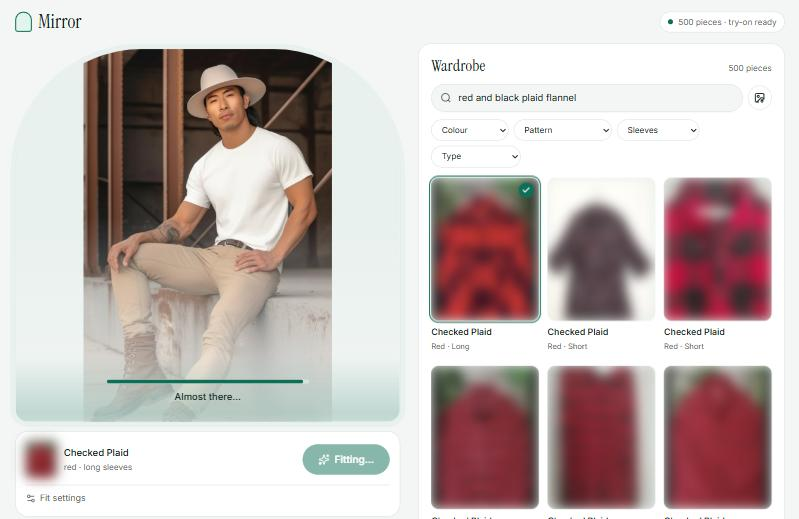

# Fashion Search · Mirror

[](https://github.com/brindeshwar/fashion-search/actions/workflows/ci.yml)


Search a wardrobe of clothing photos by **words**, **photo** or **tags**, then **see any piece
on yourself** with virtual try-on. Everything runs locally on your own GPU.



<sub>Catalogue photos are blurred in screenshots because they come from third-party listings (ADR-004). The person is FASHN's sample model photo.</sub>

## What it does

| | |
|---|---|
| **Zero-shot tagging** | Every photo gets a category, colour, pattern, sleeve and style tag from [Marqo-FashionSigLIP](https://huggingface.co/Marqo/marqo-fashionSigLIP). No training and no labels needed. |
| **Search** | Describe a garment ("red plaid flannel with long sleeves"), upload a similar photo, or filter by tags, alone or combined. |
| **Virtual try-on** | Put a garment on a photo of a person with [FASHN VTON v1.5](https://github.com/fashn-AI/fashn-vton-1.5): about 50 s on an 8 GB laptop GPU, with a before/after view. Garment photos are cleaned first ([BiRefNet](https://github.com/ZhengPeng7/BiRefNet) background removal). |
| **Mirror web app** | React + TypeScript frontend on a FastAPI backend, in light and dark themes, down to phone width. |

## Quickstart

You need Python 3.10+, Node 20+ and, for try-on, an NVIDIA GPU with about 8 GB VRAM.

```bash
git clone https://github.com/brindeshwar/fashion-search.git && cd fashion-search
python -m venv .venv
.venv/Scripts/python -m pip install torch torchvision --index-url https://download.pytorch.org/whl/cu126
.venv/Scripts/python -m pip install -e ".[tryon]"      # drop [tryon] for search only
.venv/Scripts/fashion-search tryon-download             # try-on weights, ~2.2 GB
.venv/Scripts/fashion-search index                      # embeds and tags the photos in data/shirts/
npm --prefix web ci && npm --prefix web run build
.venv/Scripts/fashion-search serve                      # open http://127.0.0.1:8000
```

Put your own garment photos in `data/shirts/` first (see [data/README.md](data/README.md)).
For the full guide (CPU-only installs, configuration, troubleshooting), see [docs/SETUP.md](docs/SETUP.md).

## How it works

```
 garment photos ──► FashionSigLIP ──► 768-d embeddings + zero-shot tags ──► artifacts/index/
                                                                                  │
 browser (React) ──► FastAPI ──► text / photo / tag search over the index ◄───────┘
                         └─────► try-on job queue ──► FASHN VTON v1.5 (GPU) ──► result PNG
```

Search is a dot product in one shared image-and-text embedding space. Tagging scores each
photo against text prompts for each tag value. Try-on runs as a background job, one at a
time on the GPU, and the page polls it for progress. Details: [docs/ARCHITECTURE.md](docs/ARCHITECTURE.md).

## Results: the 2025 model vs this one

This project replaces a 2025 course project, a small dense network trained on 28×28 grayscale
Fashion-MNIST, which is kept in [`legacy/`](legacy/2025-fashion-mnist-mlp/).

| Test | 2025 MLP (trained) | FashionSigLIP (zero-shot) |
|---|---|---|
| Fashion-MNIST test set | **87.9%** | 77.5% |
| Same images, colours inverted to look like real photos | 10.0% | **83.3%** |

The old model wins on the data it was fitted to, but it learned "light background means
shirt": it labels every inverted image "Shirt". Full table and method:
[reports/results.md](reports/results.md).

## Documentation

| | |
|---|---|
| [User guide](docs/USER_GUIDE.md) | Using the Mirror app, fit settings, limitations |
| [Setup](docs/SETUP.md) | Install, configuration, troubleshooting |
| [API](docs/API.md) | REST endpoints with examples |
| [Development](docs/DEVELOPMENT.md) | Dev loop, checks, common changes, releasing |
| [Architecture](docs/ARCHITECTURE.md) · [Decisions](docs/DECISIONS.md) · [Progress](docs/PROGRESS.md) | Design, reasoning and status |

Contributions: see [CONTRIBUTING.md](CONTRIBUTING.md). AI coding agents: start with [AGENTS.md](AGENTS.md).

## Licence

Code: [MIT](LICENSE). Models: Marqo-FashionSigLIP is Apache-2.0. FASHN VTON v1.5 is
Apache-2.0, but its human-parser component is **non-commercial only** (NVIDIA SegFormer
licence; see ADR-007). The garment photos in `data/` are not included and not licensed by
this repo.
