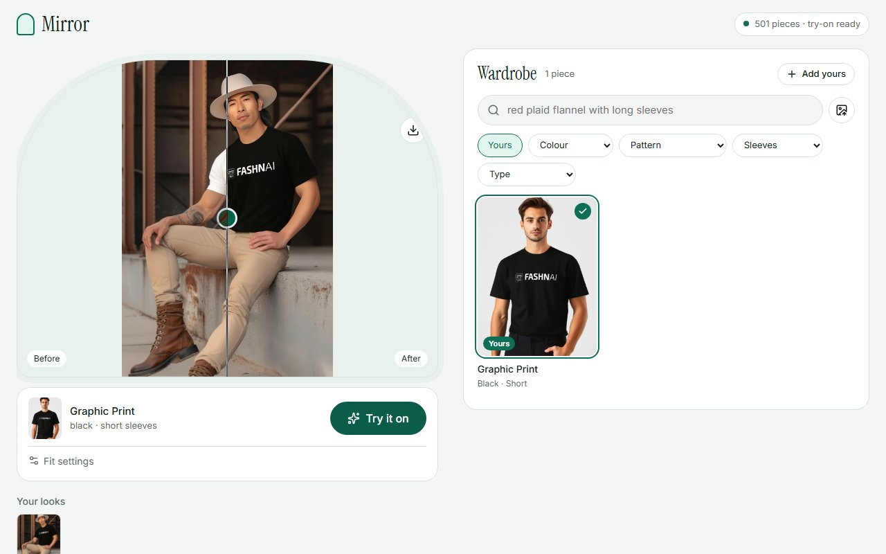

# User guide: the Mirror app

Mirror lets you search a wardrobe of clothing photos and see any piece on a photo of a
person. This guide assumes the app is installed and running (see [SETUP.md](SETUP.md)):

```bash
.venv/Scripts/fashion-search serve
```

Then open **http://127.0.0.1:8000**.



## The screen

- **Mirror (left):** your photo, and later the result.
- **Fit bar (under the mirror):** the garment you picked, the **Try it on** button, and fit settings.
- **Wardrobe (right):** every garment in the catalogue, with search and filters.
- **Status pill (top right):** how many pieces are indexed, and whether try-on is available
  ("try-on ready") or not ("search only").

On a phone or a narrow window, the mirror sits on top and the wardrobe below it.

## 1. Add your photo

Click **Choose photo**, **Take photo** (opens the camera on phones), or drag an image onto
the mirror. To remove it, use the **×** button on the mirror.

Photos that work best:

- Facing the camera, standing or sitting, with your upper body clearly visible
- One person in the frame
- Reasonable light; the background doesn't matter much

Your photo never leaves your computer: the server runs locally and keeps uploads in memory only.

## 2. Find a garment

- **Describe it:** type into the search box, for example `red plaid flannel with long sleeves`
  or `white formal office shirt`. Results update as you type, best match first.
- **Search with a photo:** click the image button next to the search box and choose a photo
  of a garment. You'll see the most similar pieces. Click **×** on the "Similar to…" chip to
  go back.
- **Filter:** use the Colour, Pattern, Sleeves and Type dropdowns. Filters combine with the
  text search, so `formal` plus Colour = white shows white formal shirts only. **Clear** resets them.
- **Show more** loads further results at the bottom of the list.

The tags (colour, pattern and so on) are generated automatically by the model, so the
occasional one will be wrong.

## 3. Try it on

Click a garment (it gets a check mark and appears in the fit bar), then click **Try it on**.
If the button is disabled, the hint underneath says why ("Add your photo first", "Pick a
garment from the wardrobe", or "Try-on is not set up on the server").

While it works, the mirror shows a progress bar and an estimate such as "about 40 s left".
A try-on takes **about 50 seconds** on an 8 GB laptop GPU, plus about 10 seconds the first
time while the model loads. If someone else's try-on is running, you'll see your place in the queue.

You can keep browsing the wardrobe while you wait.

## 4. The result

The mirror shows a **before/after** view. Drag the slider (or focus it and use the arrow
keys) to compare your original photo with the result. Use the **download** button to save
it as a PNG.

Every result from this session appears under **Your looks**, so you can compare several
garments. Looks disappear when you reload the page or restart the server.

## Fit settings

Open **Fit settings** under the Try it on button.

| Setting | What it does | Default |
|---|---|---|
| Garment photo | **On hanger / worn** suits most catalogue photos (garments on hangers, people or tables). **Flat lay** is for clean product shots laid flat. If a result looks wrong (missing sleeves, odd shape), try the other one. | On hanger / worn |
| Quality | Steps of the generation process. More steps give sharper detail but take longer (10 = fastest, 50 = sharpest). | 30 |
| Variation | A seed number. The same photo, garment and seed give the same result; change it for a slightly different take. | 42 |

## Known limitations

- **Busy garment photos give poor results.** Wrinkled shirts photographed on a bed or a
  wall, or listing photos with text and props, can come out distorted or with bits of the
  background "printed" onto the garment. Clean photos of a garment on a hanger or a person
  work well.
- **One try-on at a time.** The GPU handles one job; others wait in the queue.
- **It's slow on CPU.** Without an NVIDIA GPU, search still works, but try-on takes many minutes.
- **Tops are the focus.** The catalogue is shirts. Dresses are sent to the model as one-piece
  garments; trousers and skirts aren't in the catalogue.
- **Nothing is saved.** Results last for the session only.

## If something goes wrong

| You see | What to do |
|---|---|
| "Server offline" | The server isn't running. Start it with `fashion-search serve`. |
| "search only" and a setup hint | Try-on isn't installed. See [SETUP.md → Virtual try-on](SETUP.md#virtual-try-on-optional). |
| A yellow banner about GPU memory | Another program is using the GPU, so try-on will be very slow. Close it or wait. |
| An error in the mirror after Try it on | Click **Try again**. If it repeats, check the terminal running `serve` for the error. |
